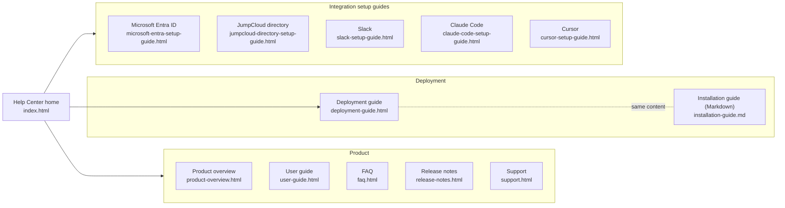
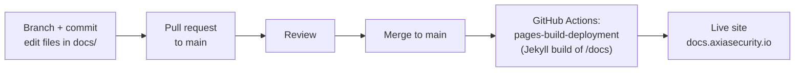

# axia-docs

[](https://github.com/Axia-Security/axia-docs/commits/main)
[](https://github.com/Axia-Security/axia-docs/actions/workflows/pages/pages-build-deployment)
[-CC0000?logo=jekyll&logoColor=white)](https://docs.github.com/en/pages/setting-up-a-github-pages-site-with-jekyll/about-github-pages-and-jekyll)

Customer-facing Axia documentation: the **Axia Security Help Center**, published with
GitHub Pages at **https://docs.axiasecurity.io/** from the `docs/` folder of `main`.

The pages are hand-written HTML with one shared stylesheet (`docs/assets/help.css`).
There is no build tooling in the repo: GitHub Pages runs its standard Jekyll build over
`docs/`, which copies the HTML as-is and renders the one Markdown file
(`docs/installation-guide.md`) to `installation-guide.html`.

> This repo is intentionally separate from internal-materials repos. Only content safe
> for customer and partner distribution belongs here.

## Contents

| Page | Source | What it covers |
| --- | --- | --- |
| Help Center home | [`docs/index.html`](docs/index.html) | Landing page linking every guide |
| Product overview | [`docs/product-overview.html`](docs/product-overview.html) | What Axia does, how data flows, shared responsibilities |
| User guide | [`docs/user-guide.html`](docs/user-guide.html) | Signing in, roles, working cases, connecting tools, settings |
| FAQ | [`docs/faq.html`](docs/faq.html) | Access, data, AI analysis and integrations |
| Release notes | [`docs/release-notes.html`](docs/release-notes.html) | What is new in each release |
| Support | [`docs/support.html`](docs/support.html) | Raising a support request or reporting a security issue |
| Deployment guide | [`docs/deployment-guide.html`](docs/deployment-guide.html) | Deploying Axia into a dedicated AWS account with Terraform |
| Installation guide (Markdown) | [`docs/installation-guide.md`](docs/installation-guide.md) | Markdown edition of the deployment guide, served as `installation-guide.html` |
| Microsoft Entra ID setup | [`docs/microsoft-entra-setup-guide.html`](docs/microsoft-entra-setup-guide.html) | Registering Axia in Entra ID for Microsoft 365 and SSO |
| JumpCloud directory setup | [`docs/jumpcloud-directory-setup-guide.html`](docs/jumpcloud-directory-setup-guide.html) | Syncing JumpCloud users as the employee directory |
| Slack setup | [`docs/slack-setup-guide.html`](docs/slack-setup-guide.html) | Creating the Axia Security Slack app and connecting it |
| Claude Code setup | [`docs/claude-code-setup-guide.html`](docs/claude-code-setup-guide.html) | Deploying the Claude Code prompt hook |
| Cursor setup | [`docs/cursor-setup-guide.html`](docs/cursor-setup-guide.html) | Deploying the Cursor prompt hook |

Other files:

- [`docs/assets/help.css`](docs/assets/help.css): shared styling.
- [`docs/CNAME`](docs/CNAME): custom domain for GitHub Pages. Do not remove it.

## Site structure



## How a change is published



Every push to `main` triggers the `pages-build-deployment` workflow, which GitHub
manages; it is not defined in this repo. A deploy usually takes about a minute. Check
progress on the [Actions tab](https://github.com/Axia-Security/axia-docs/actions).

## Preview locally

The HTML pages need no build. Serve `docs/` with any static file server:

```sh
python3 -m http.server 8000 --directory docs
# open http://localhost:8000/
```

This does not render `installation-guide.md`; view that file on GitHub or on the live
site after merge.

## Contributing

1. Create a branch from `main`.
2. Edit or add pages under `docs/`. Reuse `assets/help.css` and the header and
   navigation markup of an existing page so the new page matches the rest of the site.
3. For a new page, add a link to it on `docs/index.html` and a row to the
   [Contents](#contents) table above.
4. Check that relative links resolve and preview the page locally.
5. Open a pull request to `main`. After merge, the site updates automatically.

Write for customers and partners: no internal hostnames, account IDs, credentials or
customer names.
